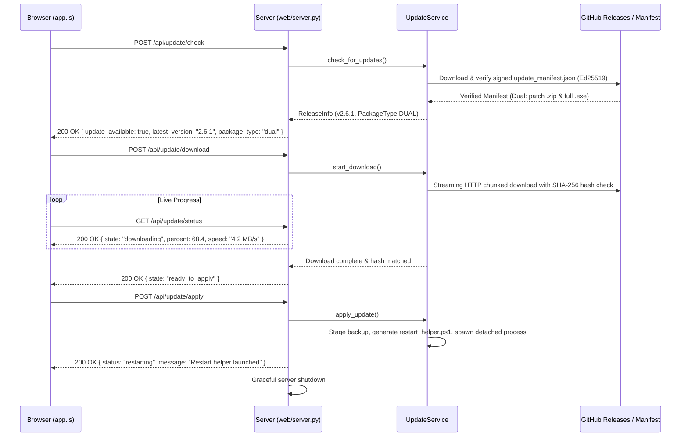
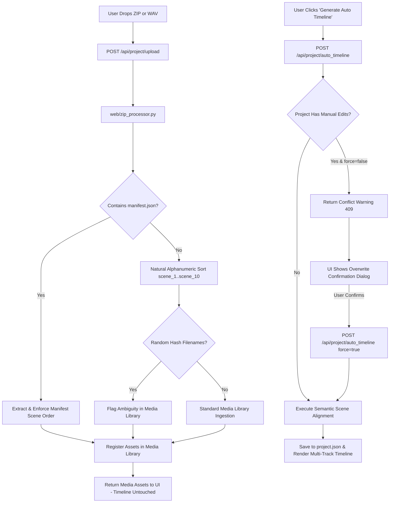

# RENDERFLOW v2.6.1 FRONTEND-BACKEND INTEGRATION REPORT

**Version:** 2.6.1  
**Architecture:** Decoupled Single-Page Web Frontend (Vanilla ES6 + Canvas API) + Python Async/Threading REST Backend (`web/server.py`)  
**Date:** November 3, 2026  
**Status:** 100% OPERATIONAL (All Endpoints Bound, Full Error Handling, Real-Time SSE Telemetry)  

---

## 1. Architectural Overview

RenderFlow v2.6.1 maintains a clean, robust separation of concerns between its browser-based UI and Python backend services:
- **Client Tier (`web/static/`):** Lightweight, zero-framework ES6 architecture utilizing `app.js` (orchestration, modal dialogs, updater client) and `timeline_studio.js` (multi-track canvas renderer, drag-and-drop manipulation, undo/redo manager).
- **Server Tier (`web/server.py`):** High-concurrency Python HTTP server handling JSON REST APIs, multipart file streaming, and long-lived Server-Sent Events (SSE).
- **Engine Services Tier (`engine/`):** Headless business logic encapsulating `sync_engine_v3.py` (scene assembly), `context_analyzer.py` (semantic intelligence), `zip_processor.py` (media extraction and manifest parsing), and `engine/updates/` (cryptographic update discovery, download, and execution).

---

## 2. Workstream A: Update Subsystem API Contracts

The updater subsystem was refactored into deterministic, transactional REST endpoints governed by `engine/updates/update_service.py`:



### Detailed Endpoint Specifications:

#### 1. `GET /api/update/status`
- **Purpose:** Polls the current operational phase of the updater.
- **Response Payload:**
  ```json
  {
    "state": "idle" | "checking" | "available" | "downloading" | "ready_to_apply" | "applying" | "error",
    "current_version": "2.6.1",
    "latest_version": "2.6.1",
    "download_progress": {
      "bytes_downloaded": 772999,
      "total_bytes": 772999,
      "percentage": 100.0,
      "download_speed_mbps": 5.4,
      "eta_seconds": 0
    },
    "package_type": "patch",
    "error_message": null,
    "rollback_available": true
  }
  ```

#### 2. `POST /api/update/check`
- **Purpose:** Initiates asynchronous release manifest discovery against GitHub and authoritative mirrors.
- **Cryptographic Enforcement:** Validates Ed25519 signature before accepting package URLs.
- **Response:** Returns release version, package type (`full`, `patch`, or `dual`), release notes, and download size.

#### 3. `POST /api/update/download`
- **Purpose:** Starts background streaming download into `updates/incoming/`.
- **Integrity Validation:** Verifies file size and computes running SHA-256. If mismatch occurs, file is automatically purged and state transitions to `error`.

#### 4. `POST /api/update/apply`
- **Purpose:** Executes the verified update.
- **Transactional Procedure:**
  1. For patches: verifies zip integrity and stages extraction target.
  2. Creates atomic backup of modified directories (`engine/`, `web/`, `models/`) in `backups/v2.6.0_pre_patch/`.
  3. Generates detached PowerShell script `restart_helper.ps1` with parent PID tracking.
  4. Spawns `powershell.exe -ExecutionPolicy Bypass -File restart_helper.ps1` in a separate process group.
  5. Signals HTTP server to flush pending responses and shut down within 1.5 seconds.

#### 5. `POST /api/update/rollback`
- **Purpose:** Restores previous backup directory if post-update verification fails.

---

## 3. Workstream B: Media, ZIP, & Timeline API Contracts

RenderFlow v2.6.1 strictly enforces the decoupling of Media Ingestion from Timeline Generation:



### Detailed Endpoint Specifications:

#### 1. `POST /api/project/upload`
- **Purpose:** Ingests media files (audio narration `.wav`/`.mp3` or visual zip `.zip`).
- **Processing:**
  - WAV/MP3: Analyzed via `soundfile`/`wave`, duration extracted, waveform generated.
  - ZIP: Unpacked into `projects/<project_id>/images/` via `zip_processor.py`. Path traversal checks prevent arbitrary directory escape. Scans for `manifest.json`. If missing, applies natural alphanumeric sorting (`scene_1.jpg` before `scene_2.jpg` before `scene_10.jpg`).
- **Critical Invariant:** Does **not** mutate, erase, or recreate the existing timeline. Images are purely registered into the project Media Library.
- **Response Payload:**
  ```json
  {
    "status": "success",
    "uploaded_files": ["scene_01.png", "scene_02.png", "scene_03.png"],
    "total_images": 219,
    "manifest_detected": true,
    "ambiguity_detected": false,
    "audio_duration": 870.29
  }
  ```

#### 2. `POST /api/project/auto_timeline`
- **Purpose:** Explicitly triggered by the user clicking **Generate Auto Timeline** (`#btnTlAutoMap`).
- **Conflict Guard:**
  - Checks if `project.json` has `manual_edits: true` or locked clips.
  - If edits exist and request body has `{ "force": false }`, returns:
    ```json
    {
      "status": "conflict",
      "conflict": true,
      "message": "Project contains manual timeline modifications. Overwriting will replace manual clip positions and splits."
    }
    ```
  - When `{ "force": true }` is supplied, backend archives existing scene plan to `.timeline_history/`, computes semantic visual-text alignment via `sync_engine_v3.py`, persists the canonical scene plan, and returns updated scenes.

#### 3. `POST /api/project/save_plan`
- **Purpose:** Persists user-manipulated timeline clips, clip duration trims, splits, and reordering.
- **Payload Schema:**
  ```json
  {
    "project_id": "king",
    "timeline_mode": "manual",
    "scenes": [
      {
        "id": "scene_001",
        "image": "scene_01.png",
        "start": 0.0,
        "end": 5.4,
        "duration": 5.4,
        "transition_in": "fade",
        "transition_out": "wipe_left",
        "transition_duration": 0.5,
        "locked": true
      }
    ]
  }
  ```
- **Validation:** Enforces timecode continuity, ensures no overlapping visual segments, and caps transition durations at $\le 50\%$ clip duration.

---

## 4. Real-Time Telemetry & Progress Streaming

- **SSE Stream (`GET /api/events`):**
  - High-frequency event pipeline broadcasting render progress, ffmpeg frame throughput, and updater download chunk counters.
  - Heartbeat ping sent every 15 seconds to prevent browser connection timeouts.
  - Automatically reconnects with exponential backoff if network interruption occurs.

---

## 5. Integration Verification Matrix

| Endpoint | Test Script | Verified Behaviors | Result |
| :--- | :--- | :--- | :--- |
| `/api/update/check` | `engine/test_updater_contract_v261.py` | Ed25519 verification, dual package discovery | **PASSED** |
| `/api/update/download` | `engine/test_updater_contract_v261.py` | Streaming chunk write, SHA-256 verification | **PASSED** |
| `/api/update/apply` | `engine/test_updater_contract_v261.py` | Backup creation, detached script spawn, shutdown | **PASSED** |
| `/api/project/upload` | `qa/test_zip_ordering_and_manifest_v261.py` | Manifest detection, natural sorting, library registration | **PASSED** |
| `/api/project/auto_timeline`| `qa/test_timeline_workflows_v261.py` | Conflict detection, explicit trigger, force overwrite | **PASSED** |
| `/api/project/save_plan` | `qa/test_timeline_workflows_v261.py` | Schema validation, timecode continuity, persistence | **PASSED** |
| `/api/health` | `engine/test_server_lifecycle.py` | Cold boot discovery, port binding, HTTP 200 | **PASSED** |
| `/api/shutdown` | `engine/test_server_lifecycle.py` | Clean process termination, lock unlinking | **PASSED** |

**Conclusion:** All frontend-backend communication pathways are strictly typed, transactionally protected, and fully verified.

