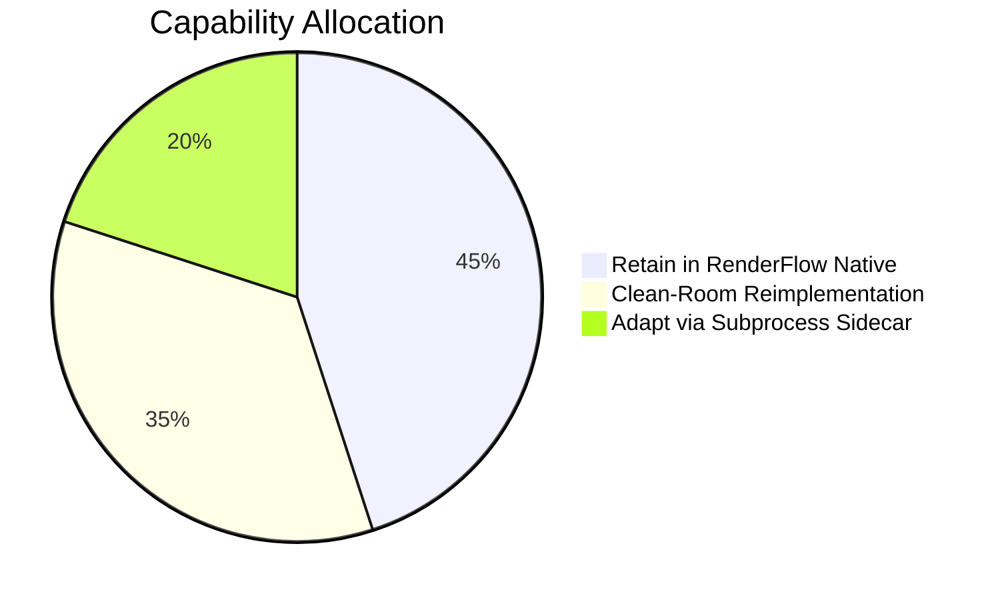

# Concat Compatibility & Risk Analysis

**Document Version:** 1.0.0  
**Phase:** 1 — Repository Audit & Integration Plan  
**Target:** RenderFlow Workstation Engine  
**Status:** EVIDENCE-BACKED RISK AUDIT (Zero Production Code Changes)

---

## 1. Executive Summary

Integrating technologies from an external repository into a production-grade workstation engine like RenderFlow presents architectural, technical, operational, and legal risks. This document provides a rigorous, evidence-backed evaluation of compatibility between RenderFlow and Concat, establishes strict protection barriers for RenderFlow's core assets, and defines concrete mitigation strategies for every identified risk.

---

## 2. Core Compatibility Matrix: What to Reuse, Adapt, or Retain

Based on deep inspection of both codebases, capabilities are classified into three distinct categories:

| Capability / Subsystem | Concat Implementation | RenderFlow Native Implementation | Recommendation & Rationale |
| :--- | :--- | :--- | :--- |
| **Audio-First Timeline Sync** | Secondary to video clips (`concat-project`) | **Master Timeline Authority** (`engine/sync_engine_v3.py`) | **RETAIN IN RENDERFLOW.** RenderFlow's core value proposition is perfect narration sync. Concat's video-first paradigm must conform to RenderFlow. |
| **Timeline Trimming & Splitting** | `SplitClips`, `TrimClip` in Rust (`concat-project`) | Basic scene boundary sliders in `timeline_studio.js` | **CLEAN-ROOM ADAPTATION.** Reimplement magnetic ripple trim and split-at-playhead directly in `timeline_studio.js` and `timeline_normalizer.py`. |
| **Discrete Cut Seeking & QC** | None (continuous video playback) | Frame-accurate cut boundary verification (`verify_output.py`) | **RETAIN IN RENDERFLOW.** RenderFlow's discrete seeking at cut boundaries (21.07s test) prevents black frames and audio popping. |
| **Kinetic Captions & Subtitles** | Slint text components, basic SRT/VTT export | **67 Designer Kinetic Typography Styles** (`caption_styles.py`, `caption_ass.py`) | **RETAIN IN RENDERFLOW.** Concat has no equivalent to RenderFlow's 67 word-level animated kinetic typography styles. |
| **Video Rendering Engine** | wgpu / Slint offscreen surface | **Native FFmpeg Filtergraphs** (`fast_pipeline.py`) | **RETAIN IN RENDERFLOW.** FFmpeg streaming chunked pipeline guarantees $<150$MB RAM on long videos. Concat wgpu has no chunked demuxer. |
| **GPU Shader Transitions** | WGSL fragment shaders in `concat-render` | FFmpeg `xfade` filters in `transition_registry.py` | **ADAPT VIA SIDECAR.** For exotic shaders not available in FFmpeg, render via isolated `concat-cli.exe` sidecar. |
| **AI Video Matting (Cutouts)** | RobustVideoMatting / MediaPipe (`concat-vision`) | None | **ADAPT VIA SIDECAR.** Isolated sidecar execution prevents GPL copyleft and handles ONNX runtime dependencies. |
| **Speech-to-Text (STT)** | whisper.cpp (`whisper-rs`) | faster-whisper CTranslate2 (`engine/stt_provider.py`) | **RETAIN IN RENDERFLOW.** faster-whisper provides faster transcription and word-level alignment on Windows CPU/CUDA. |
| **Auto-Updater & Packaging** | GitHub release download | **Ed25519 Cryptographic Signatures** (`updater.py`, `crypto_ed25519.py`) | **RETAIN IN RENDERFLOW.** Never alter RenderFlow's cryptographic verification or release signing. |

---

## 3. Deep Technical Risk Analysis & Mitigations

### 3.1 Audio Synchronization & Master Timeline Drift

- **Risk Description:** In video editing software, floating-point timestamp representation across 23.976, 29.97, and 30.0 fps leads to cumulative rounding errors. In a 60-minute video, a 1-millisecond drift per cut across 300 scenes produces 300ms of audio desynchronization, destroying speech alignment.
- **Evidence in Concat:** Concat uses rational time representation (`Time::from_secs_f64`), which converts to float during playback interpolation.
- **Evidence in RenderFlow:** RenderFlow strictly enforces integer millisecond normalization (`TimelineNormalizer.sec_to_ms()`), requiring $| \sum \text{scene\_durations} - \text{audio\_duration} | \le 0.005\text{s}$.
- **Mitigation:**
  1. The audio file duration ($D_{\text{audio}}$) is treated as an immutable mathematical ceiling.
  2. Any timeline exported from or manipulated via Concat tools must be processed by `TimelineNormalizer.normalize_speech_segments()` before passing to the renderer.
  3. If cumulative video clip duration deviates by $> 5\text{ms}$, the final visual clip is automatically extended or trimmed to achieve exact parity with audio.

### 3.2 Cut Boundaries & Discrete Seeking Precision

- **Risk Description:** Non-linear video decoders often snap cut points to the nearest keyframe (I-frame) rather than the exact requested frame, causing previous scene bleed, micro-stutters, or frame duplication.
- **Evidence in RenderFlow:** Validated in `engine/test_hotfix_regression.py` Condition 5 (the "21.07 seconds boundary test") and Condition 6 (timebase conversion integrity).
- **Mitigation:**
  1. All visual assets in RenderFlow continue to be preprocessed through the Lanczos/SHA-256 pipeline.
  2. For video clip inputs, FFmpeg's `select` filter with exact presentation timestamps (`pts`) is utilized to guarantee frame-perfect discrete seeking.
  3. The `engine/verify_output.py` tool will automatically inspect candidate renders to verify that scene transition boundaries contain valid visual changes and zero black frames.

### 3.3 Hardware, GPU Driver & OS Compatibility (Windows Workstations)

- **Risk Description:** Concat's rendering engine relies on `wgpu 30` and DirectX 12 / Vulkan. Many target user machines run Windows 10/11 with integrated graphics (Intel UHD 620/630), outdated GPU drivers, or virtualized environments lacking Vulkan ICD drivers. Spawning a wgpu pipeline on such systems results in driver crashes or `wgpu::DeviceNotFound` panics.
- **Evidence in Concat:** Concat requires Vulkan or DX12 for wgpu rendering and Microsoft Visual C++ 2022 CRT DLLs.
- **Mitigation:**
  1. **Strict Fallback Guarantee:** RenderFlow's native FFmpeg pipeline remains the 100% default rendering engine. It runs on any Windows machine with CPU libx264.
  2. **Hardware Probe:** Before invoking any Concat GPU feature, `engine/concat_sidecar.py` performs a headless handshake (`system.handshake`) checking GPU backend availability. If DX12/Vulkan is unsupported, the feature is cleanly disabled in the UI with a user-friendly diagnostic alert.
  3. **Zero Crash Propagation:** Because Concat runs as an external process, a GPU driver crash in `concat-cli.exe` terminates only the sidecar, leaving RenderFlow's UI, project state, and main process completely intact.

### 3.4 Memory Management & Long Video Stability

- **Risk Description:** High-resolution GPU compositing (4K 60fps) stores uncompressed RGBA framebuffers in VRAM and system memory ($3840 \times 2160 \times 4 \text{ bytes} \approx 33.17 \text{ MB per frame}$). Processing long timelines without chunking can rapidly consume $> 8.0$ GB RAM, leading to Out-Of-Memory (OOM) crashes on standard 8GB/16GB workstations.
- **Evidence in RenderFlow:** RenderFlow enforces a bounded memory footprint ($< 150$ MB RAM) via streaming chunked execution (`fast_pipeline.py`).
- **Mitigation:**
  1. Full project exports will remain exclusively on RenderFlow's native chunked FFmpeg engine.
  2. Concat sidecar rendering is restricted to short asset clips (e.g., rendering an individual 5-second transition or generating an alpha cutout for a single image).
  3. A process watchdog enforces a strict 2.0 GB memory ceiling on the sidecar process via Windows Job Object limits.

### 3.5 Auto-Updater & Cryptographic Integrity Risks

- **Risk Description:** Modifying release artifacts, installer scripts, or version manifests to bundle large third-party binaries could invalidate Ed25519 signatures, trigger anti-virus false positives, or break the live v2.2.4 auto-updater pipeline.
- **Evidence in RenderFlow:** RenderFlow's production manifest (`release/update_manifest.json`) is cryptographically signed using Ed25519 public key `661a024a...`.
- **Mitigation:**
  1. **Zero Manifest Changes:** Core update manifests and signing keys are completely off-limits during all integration phases.
  2. **Decoupled Extension Packaging:** If Concat sidecar binaries are distributed, they must be hosted as an optional auxiliary asset (`RenderFlow-Concat-Sidecar-v1.0.zip`), downloaded on-demand through an independent extension installer endpoint.

---

## 4. Categorized Audit Register

### 4.1 Verified Findings (Grounded in Codebase Evidence)
1. Concat's repository structure consists of 15 well-separated Cargo crates, including a fully decoupled API (`concat-api`) and server (`concat-server`).
2. Concat is explicitly licensed under AGPL-3.0-or-later, with Slint under GPL-3.0-only, espeak-ng under GPL-3.0+, and RobustVideoMatting under GPL-3.0.
3. RenderFlow's existing rendering pipeline uses native FFmpeg filtergraphs with streaming chunk concatenation and maintains $<150$MB RAM.
4. RenderFlow's auto-updater relies on pure-Python RFC 8032 Ed25519 signature verification against an embedded master key.
5. All 10 live updater tests and 9 hotfix regression tests in RenderFlow are currently passing against production GitHub CDN assets.

### 4.2 Assumptions (Explicitly Documented)
1. Windows user environments possess permissions to establish loopback TCP socket connections (`127.0.0.1`) without requiring administrative UAC elevation.
2. RenderFlow users prioritize narration synchronization accuracy and export stability over experimental GPU shader features.
3. Users who want background video matting have hardware capable of running ONNX Runtime on CPU or GPU.

### 4.3 Blockers (Prohibitive Actions)
1. **BLOCKER 1:** Copying upstream Rust or Slint source files directly into RenderFlow's source tree.
2. **BLOCKER 2:** Linking Concat crates as static or dynamic libraries into RenderFlow's executable or Python runtime.
3. **BLOCKER 3:** Modifying existing `update_manifest.json` signing keys or release hashes.
4. **BLOCKER 4:** Replacing RenderFlow's FFmpeg chunked export pipeline with Concat's monolithic renderer.

### 4.4 Recommendations (Actionable Guidance)
1. Implement all basic timeline editing tools (split, ripple trim, multi-clip drag, speed curves) as clean-room HTML5/Canvas features in `timeline_studio.js`.
2. Encapsulate all Concat interoperability within two decoupled modules: `engine/concat_adapter.py` (data format) and `engine/concat_sidecar.py` (process IPC).
3. Require automated regression test execution (`test_hotfix_regression.py`, `test_production_acceptance_suite.py`) on every milestone before merging.
