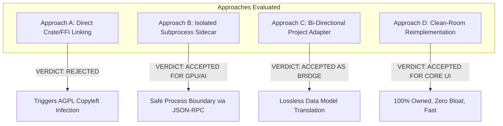
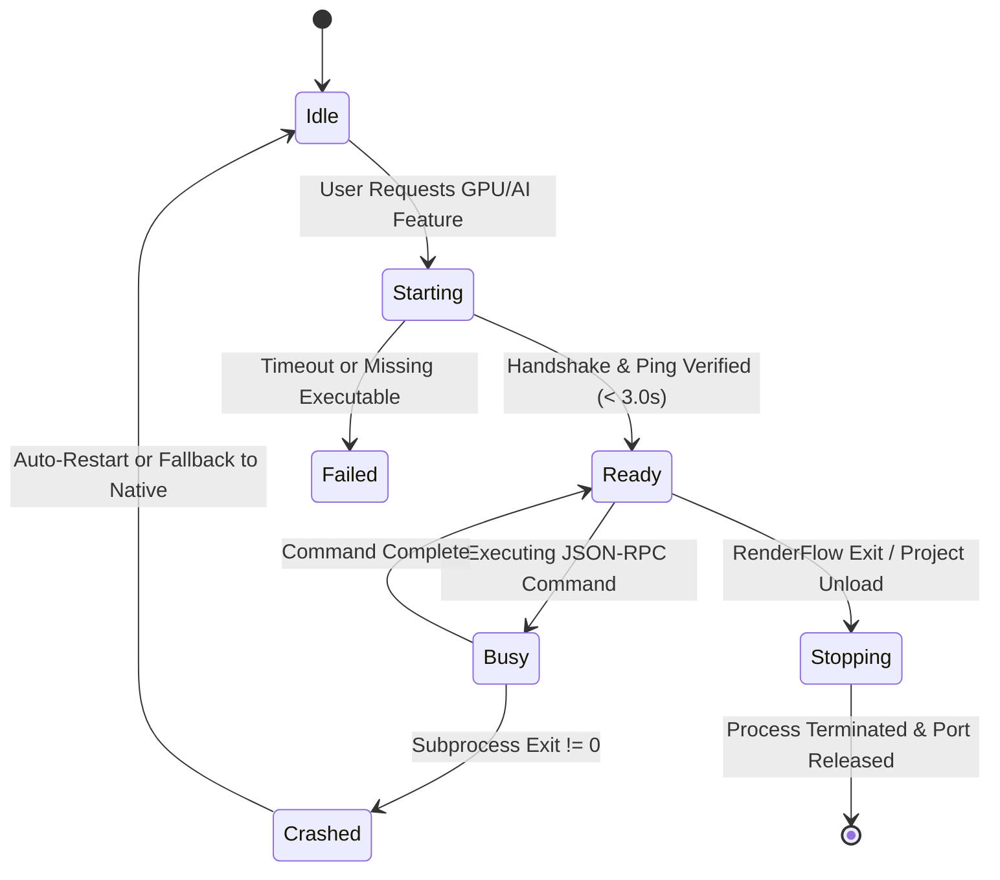

# Concat Integration Architecture & System Design

**Document Version:** 1.0.0  
**Phase:** 1 — Repository Audit & Integration Plan  
**Target:** RenderFlow Workstation Engine  
**Integration Target:** Concat (v0.2.7)  
**Status:** EVIDENCE-BACKED ARCHITECTURE DESIGN (Zero Production Code Changes)

---

## 1. Evaluation of Integration Approaches

Four potential architectural integration strategies were evaluated against five mandatory criteria:
1. **Licensing Compliance:** Absolute insulation of RenderFlow from AGPL-3.0 and GPL-3.0 copyleft obligations.
2. **Audio-First Invariant:** Total preservation of master audio duration, speech rhythm, and cut boundaries.
3. **Workstation Stability & Performance:** Sub-150MB RAM footprint, zero memory leaks, and robust crash isolation.
4. **Windows Deployment Simplicity:** Compatibility with Inno Setup, single-binary distribution, and auto-updater.
5. **Maintainability:** Long-term decoupled evolution without fragile bindings or ABI breakage.



### Approach A: Integrating Selected Concat Modules (Direct Linking / FFI)
- **Mechanism:** Compiling `concat-project` or `concat-render` into a C-ABI DLL or PyO3 Python extension loaded into `renderflow.exe`.
- **Source Evidence:** Upstream Concat is written in Rust, linking Slint (GPL-3.0-only), `ffmpeg-the-third` (GPL-2.0+), and espeak-ng (GPL-3.0+).
- **Assessment:** **CRITICAL REJECTION.** Direct in-process linking creates a combined derivative work under international copyright law. This would trigger the AGPL-3.0 copyleft clause, legally forcing RenderFlow to open-source its proprietary composition engine, LLM providers, and credentials manager. Furthermore, PyO3/C-ABI bindings across Rust and Python introduce complex Windows build toolchain dependencies (MSVC, LLVM, Cargo) for downstream builds.

### Approach B: Running Concat as an Isolated Subprocess / Service
- **Mechanism:** Spawning a headless Concat service (`concat-cli.exe serve --json 127.0.0.1:<port>`) as an independent OS background process communicating via JSON-RPC 2.0 over loopback TCP.
- **Source Evidence:** Verified in upstream crate `concat-cli` and `concat-server`. Concat natively supports headless operation, JSON-RPC command execution, project loading, and off-screen frame rendering.
- **Assessment:** **STRONGLY VIABLE FOR ADVANCED FEATURES.** Satisfies FSF criteria for separate independent programs. A crash in Concat cannot crash RenderFlow. Memory footprint is strictly isolated. Perfect for heavy GPU shader passes or background matting.

### Approach C: Building a Data Model Adapter
- **Mechanism:** Constructing a bi-directional serialization layer (`engine/concat_adapter.py`) translating RenderFlow's `plan.json` into Concat's `Document` schema (and vice versa).
- **Source Evidence:** Upstream project model in `concat-project::models` uses tracks, clips, transitions, and keyframes. RenderFlow uses audio-first scenes with transition descriptors.
- **Assessment:** **ESSENTIAL FOUNDATION.** Enables project interchange, allowing RenderFlow projects to be rendered through Concat's shader engine or exported to Concat for manual external fine-tuning.

### Approach D: Reimplementing Compatible Capabilities Clean-Room
- **Mechanism:** Independently implementing timeline editing interactions (split, trim, magnetic ripple, multi-clip drag, speed curves) in RenderFlow's native HTML5/Canvas `timeline_studio.js` and Python `timeline_normalizer.py`.
- **Source Evidence:** Editing operations are mathematical transformations on interval sets $[t_{\text{start}}, t_{\text{end}}]$.
- **Assessment:** **STRONGLY RECOMMENDED FOR TIMELINE EDITING.** Delivers instant UI responsiveness (zero IPC network latency), requires zero extra binary downloads, preserves 100% proprietary code ownership, and inherently respects RenderFlow's audio-first master timeline.

---

## 2. Selected Strategy: The Hybrid Decoupled Architecture

Based on source-code evidence and legal analysis, RenderFlow adopts a **Hybrid Decoupled Architecture**:

```text
+---------------------------------------------------------------------------------------+
|                               RENDERFLOW WORKSTATION                                  |
|                                                                                       |
|   +-------------------------------------------------------------------------------+   |
|   |                       Frontend UI: Timeline Studio                            |   |
|   |   (Clean-room HTML5/Canvas: Split, Ripple Trim, Multi-Select, Speed Curves)   |   |
|   +-------------------------------------------------------------------------------+   |
|                                          |                                            |
|                                          v                                            |
|   +-------------------------------------------------------------------------------+   |
|   |                    Backend: TimelineNormalizer & Server                       |   |
|   |          (Audio-First Validation, Integer-MS Precision, Zero Gaps)            |   |
|   +-------------------------------------------------------------------------------+   |
|               |                                                   |                   |
|               v                                                   v                   |
|   +-----------------------+                           +-----------------------+       |
|   |  RenderFlow Native    |                           |  Concat Adapter &     |       |
|   |  FFmpeg Engine        |                           |  Sidecar Manager      |       |
|   |  (Default Fast Path)  |                           |  (Optional Extension) |       |
|   +-----------------------+                           +-----------------------+       |
|               |                                                   |                   |
+---------------|---------------------------------------------------|-------------------+
                |                                                   | Loopback TCP
                | Native Subprocess Pipe                            | JSON-RPC 2.0
                v                                                   v
     +---------------------+                             +---------------------+
     |   bin/ffmpeg.exe    |                             |   concat-cli.exe    |
     |   (FFmpeg 9.0.2)    |                             |  (Isolated Sidecar) |
     +---------------------+                             +---------------------+
```

1. **Tier 1 (Core Non-AI Timeline — 100% Clean-Room):**  
   All timeline manipulation tools (split, trim, magnetic ripple, clip positioning, mute, speed adjustment) operate directly inside RenderFlow's native UI (`web/static/js/timeline_studio.js`) and Python normalization engine (`engine/timeline_normalizer.py`). This delivers zero latency and requires no external binary.
2. **Tier 2 (Project Interoperability Adapter):**  
   `engine/concat_adapter.py` translates between RenderFlow's `plan.json` and Concat's project document format, ensuring semantic compatibility.
3. **Tier 3 (Optional Sidecar Service):**  
   `engine/concat_sidecar.py` manages an optional, standalone `concat-cli.exe` background process. When installed, it provides GPU shader effects, cutout matting, or alternative rendering via loopback JSON-RPC without contaminating RenderFlow's legal status.

---

## 3. Data Contracts & Protocol Specification

### 3.1 Data Model Mapping (`plan.json` $\longleftrightarrow$ Concat `Document`)

| RenderFlow `plan.json` Entity | Concat Document Model Entity (`concat-project`) | Mapping & Conversion Rules |
| :--- | :--- | :--- |
| `project.audio_path` | Master Audio Track Clip (`TrackKind::Audio`) | Placed on Track 0 at offset 0. Master duration reference. |
| `project.fps` (e.g. 30) | `Document.framerate` (`Framerate::Fps30`) | Direct 1:1 mapping. |
| `project.resolution` (1920x1080) | `Document.resolution` (1920, 1080) | Direct 1:1 mapping. |
| `scenes[i].scene_id` | `Clip.id` (`Uuid::new_v4()`) | Mapped via deterministic ID translation dictionary. |
| `scenes[i].start_time` | `Clip.range.start` (`Time::from_secs_f64()`) | Converted to integer timebase ticks. |
| `scenes[i].end_time` | `Clip.range.end` (`Time::from_secs_f64()`) | Converted to integer timebase ticks. |
| `scenes[i].image_path` | `ClipMedia::Image(AssetId)` | Registered in `Document.assets` with SHA-256 fingerprint. |
| `scenes[i].transition_in` | `Transition` (`TransitionKind::Crossfade`, etc.) | Mapped to closest Concat GPU shader equivalent. |
| `scenes[i].transition_duration` | `Transition.duration` | Clamped to $\le 50\%$ of adjacent clip duration. |
| `captions` array | Captions Track (`TrackKind::Text`) | Converted from ASS word tokens to Concat text spans. |

### 3.2 Sidecar JSON-RPC 2.0 API Specification

Communication between RenderFlow and `concat-cli.exe` uses newline-delimited JSON-RPC 2.0 over loopback TCP (`127.0.0.1:<dynamic_port>`).

#### Method: `system.handshake`
- **Request:**
  ```json
  {
    "jsonrpc": "2.0",
    "id": 1,
    "method": "system.handshake",
    "params": {
      "client": "RenderFlow-Workstation",
      "client_version": "2.2.4",
      "protocol_version": "1.0"
    }
  }
  ```
- **Response:**
  ```json
  {
    "jsonrpc": "2.0",
    "id": 1,
    "result": {
      "status": "ready",
      "server_version": "0.2.7",
      "gpu_backend": "Vulkan",
      "supported_effects": ["dissolve", "wipe", "zoom_blur", "matting_rvm"]
    }
  }
  ```

#### Method: `project.load_document`
- **Request:** Passes the translated Concat document JSON payload.
- **Response:** Returns `{ "status": "loaded", "clip_count": 24, "duration_ms": 124500 }`.

#### Method: `effects.apply_cutout`
- **Request:** Requests background removal for an asset using a specific ONNX model (MediaPipe or RVM).
- **Response:** Returns `{ "status": "completed", "output_alpha_path": "..." }`.

---

## 4. Subprocess Lifecycle & Process Guard

To ensure RenderFlow's workstation reliability is never compromised by an external process, `engine/concat_sidecar.py` implements a strict lifecycle state machine:



### Safety Guarantees:
1. **Dynamic Ephemeral Port Allocation:** Binds to an OS-assigned ephemeral port (using `socket.bind(('127.0.0.1', 0))`) preventing port collision with other workstation services.
2. **Process Guard & Termination:** On Windows, the subprocess is registered with a Win32 Job Object configured with `JOB_OBJECT_LIMIT_KILL_ON_JOB_CLOSE`. If RenderFlow exits, crashes, or is killed in Task Manager, Windows automatically and instantly terminates `concat-cli.exe`, preventing orphaned background processes.
3. **Heartbeat & Health Watchdog:** A periodic ping (`system.ping`) verifies responsiveness every $5.0$ seconds during active tasks. If a timeout exceeds $15.0$ seconds, the sidecar is recycled and the task falls back to RenderFlow's native FFmpeg pipeline.

---

## 5. Core Protection & Regression Defense

The integration design guarantees that RenderFlow's core engine remains protected:

1. **Audio-First Synchronization Protection:**  
   The Concat sidecar is never permitted to dictate master duration. Any timeline modification originating from Concat document data must pass through `TimelineNormalizer.normalize_speech_segments()`. If Concat's output timeline deviates by $> 0.005$ seconds from the audio track, `TimelineNormalizer` automatically snaps cut boundaries to audio beats.
2. **Deterministic Cut Boundary Protection:**  
   RenderFlow's existing test fixture (`engine/test_hotfix_regression.py`) verifies scene transitions, 21.07-second boundary alignment, and chunk offsets. These exact tests must run against any integrated workflow.
3. **Update Manifest & Signing Invariance:**  
   The optional Concat sidecar binary is strictly excluded from RenderFlow's core update manifests (`update_manifest.json`, `bundle_manifest.json`). It is distributed as an independent extension package, ensuring RenderFlow's Ed25519 signing keys and update pipelines remain untouched.
