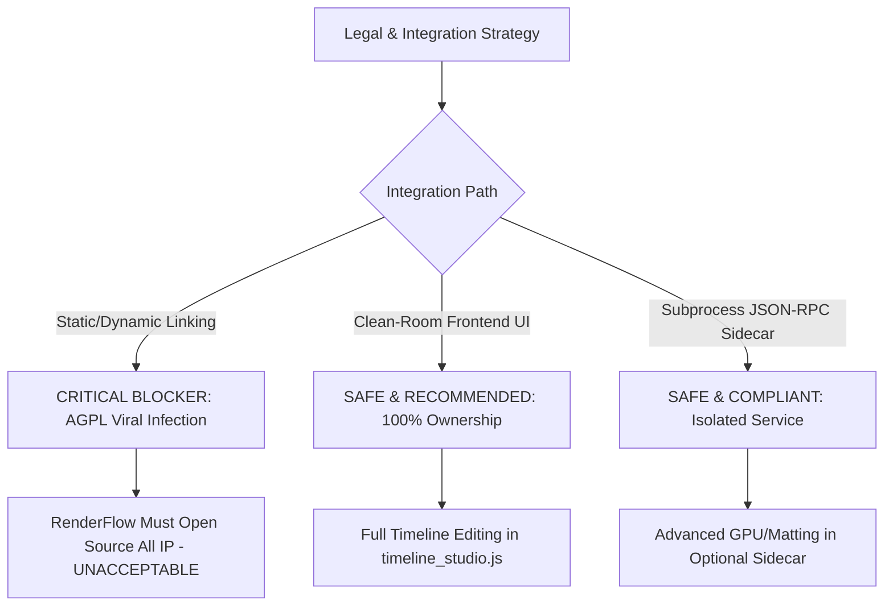

# Concat License & Dependency Review

**Document Version:** 1.0.0  
**Phase:** 1 — Repository Audit & Integration Plan  
**Target:** RenderFlow Workstation Engine  
**Upstream Target:** Concat (Commit `e4a6a57`, Release v0.2.7)  
**Status:** EVIDENCE-BACKED AUDIT (Zero Production Code Changes)

---

## 1. Executive Summary & Core Legal Finding

A comprehensive audit of the upstream Concat repository (`scratch/concat_upstream`), specifically examining `LICENSE`, `THIRD_PARTY_NOTICES.md`, `Cargo.toml`, and crate dependency manifests, yields an unambiguous legal conclusion:

> **CRITICAL LEGAL FINDING:**  
> Concat's core codebase is licensed under the **GNU Affero General Public License Version 3 or later (AGPL-3.0-or-later)**. Furthermore, its GUI runtime links against **Slint under GNU GPL-3.0-only**, its speech runtime incorporates **espeak-ng under GPL-3.0-or-later**, its video matting includes **RobustVideoMatting under GPL-3.0**, and its bundled FFmpeg binaries compile against **x264 under GPL-2.0-or-later**.
>
> **IMPLICATION FOR RENDERFLOW:**  
> Direct source code copying, static linking, or in-process dynamic linking (FFI/DLL) of Concat crates into RenderFlow's proprietary codebase is **STRICTLY PROHIBITED**. Doing so would create a derivative combined work and trigger the viral copyleft obligations of AGPL-3.0 / GPL-3.0, legally forcing RenderFlow's proprietary rendering pipeline, cloud credentials manager, and closed-source assets to be released under the AGPL.
>
> **RECOMMENDED LEGAL REMEDY:**  
> 1. **Clean-Room Frontend Reimplementation:** Non-AI timeline editing semantics (split at playhead, magnetic ripple trim, multi-selection drag, speed curves) must be designed clean-room in RenderFlow's existing HTML5/Canvas `timeline_studio.js` and Python FastAPI backend without copying any upstream Rust or Slint source code.  
> 2. **Arm's-Length Subprocess Isolation (Optional Sidecar):** If advanced GPU effects or AI cutout capabilities from Concat are packaged, they must run strictly as a standalone, separate binary (`concat-cli.exe serve --json 127.0.0.1:PORT`) communicating exclusively over loopback TCP via JSON-RPC. This satisfies Free Software Foundation (FSF) criteria for independent programs communicating across an OS process boundary.

---

## 2. Upstream License Analysis: AGPL-3.0-or-Later

### 2.1 The AGPL-3.0 Grant
The root file `scratch/concat_upstream/LICENSE` confirms that Concat is licensed under the GNU Affero General Public License, version 3, dated 19 November 2007.

Key statutory clauses analyzed:
- **Section 5 (Conveying Modified Source Versions):** Mandates that any modified version must carry prominent notices stating that it was modified, and must license the entire work as a whole under the AGPL to anyone who comes into possession of a copy.
- **Section 13 (Remote Network Interaction):** Specifically requires that if you run a modified program on a server and let other users communicate with it over a computer network, you must offer all users the corresponding source code of your modified version through a network server at no charge.
- **Section 13 Combinations:** AGPL-3.0 expressly permits linking covered code with code licensed under GNU GPL version 3 into a single combined work.

### 2.2 Impact of Section 13 on RenderFlow Workstation
RenderFlow operates primarily as a desktop application with a local web UI (`localhost:8000`). Under standard GPL-3.0, purely private localhost execution does not trigger source distribution to remote users. However, under **AGPL-3.0 Section 13**, if RenderFlow's server component were ever exposed to LAN, multi-user remote collaboration, or cloud rendering, Section 13 would immediately require public disclosure of the entire modified source repository if directly linked.

---

## 3. Comprehensive Third-Party License Inventory

An exhaustive review of `THIRD_PARTY_NOTICES.md` and crate manifests identifies the following third-party components, their licensing terms, and their distribution constraints:

| Component / Subsystem | Upstream Location / Source | License | Copyleft Type | Redistribution & Linking Restrictions |
| :--- | :--- | :--- | :--- | :--- |
| **Concat Core & Crates** | `src/crates/*` | **AGPL-3.0-or-later** | Strong Copyleft | Cannot be statically or dynamically linked into proprietary applications. |
| **Slint UI Framework** | `src/crates/concat` | **GPL-3.0-only** | Strong Copyleft | Slint offers royalty-free, commercial, or GPL-3.0. Upstream Concat explicitly chose **GPL-3.0-only**. Combines with AGPL via §13. |
| **FFmpeg + libx264** | `ffmpeg-the-third` crate / BtbN | **GPL-2.0-or-later** (due to x264) | Strong Copyleft | Prebuilt FFmpeg shared libraries carry GPL-2.0+ due to libx264 encoder. |
| **espeak-ng** | `src/crates/concat-speech` / sherpa-onnx | **GPL-3.0-or-later** | Strong Copyleft | Grapheme-to-phoneme dictionary and engine. Triggers GPL copyleft if bundled into shared binary. |
| **Robust Video Matting (RVM)** | `models/` (MobileNetV3 variant) | **GPL-3.0** | Strong Copyleft | AI model weights and pipeline licensed under GPL-3.0. Downloaded on demand. |
| **sherpa-onnx** | `src/crates/concat-speech` | **Apache-2.0** | Permissive | Runtime for TTS. Notice and attribution required. |
| **ONNX Runtime (ort)** | `src/crates/concat-vision` | **MIT / Apache-2.0** | Permissive | Microsoft ONNX Runtime binaries (`onnxruntime.dll`). Notice required. |
| **MediaPipe Selfie Segmentation** | `src/crates/concat-vision` | **Apache-2.0** | Permissive | Embedded default portrait matting model. Notice required. |
| **IS-Net (DIS / rembg)** | Model mirror / rembg | **Apache-2.0** | Permissive | Highly accurate dichotomous image segmentation. |
| **SlimSAM** | Model mirror | **Apache-2.0** | Permissive | Segment Anything lightweight model for brush cutouts. |
| **whisper.cpp / whisper-rs** | `src/crates/concat-speech` | **MIT** | Permissive | STT engine and ggml bindings. Notice required. |
| **Kokoro-82M Voices** | Model mirror / hexgrad | **Apache-2.0** | Permissive | High quality TTS voice weights. Notice required. |
| **Pocket TTS** | Kyutai / KevinAHM | **CC-BY-4.0** | Permissive w/ Attribution | Delayed streams speech modeling. Requires voice owner consent. |
| **Chatterbox Turbo** | Resemble AI | **MIT** | Permissive | Text-to-speech ONNX model. Notice required. |
| **Base Fonts (24 families)** | `src/crates/concat-text/fonts/` | **SIL OFL 1.1** / Apache-2.0 | Permissive Font License | Inter, Montserrat, Archivo Black, etc. Must carry OFL notices. Cannot be sold alone. |
| **MSVC CRT (Windows)** | Visual Studio Redistributable | **Proprietary (Microsoft REDIST)** | Vendor Permissive | Permitted for redistribution alongside compiled Windows binaries. |

---

## 4. Legal Isolation Assessment: Linking vs Subprocess IPC

### 4.1 Why Direct In-Process Linking is a Critical Blocker
In software licensing law and Free Software Foundation jurisprudence:
1. **Static Linking:** Compiling Rust crates from Concat (e.g., `concat-project`, `concat-render`) into a RenderFlow dynamic library (`.pyd` or `.dll`) creates an indisputable single derivative work. RenderFlow would become entirely subject to the AGPL-3.0.
2. **FFI Dynamic Linking:** Creating a C-ABI shared library (`concat_c_api.dll`) and loading it into Python via `ctypes` or `cffi` within the RenderFlow process is consistently treated by the FSF and legal precedents as dynamic linking forming a single combined work.
3. **Data Structure Coupling:** Sharing rich, internal in-memory object graphs (e.g. Slint DOM pointers, direct memory framebuffers) across language boundaries without a formal protocol reinforces the derivative work classification.

### 4.2 The Legally Safe Boundary: Arm's-Length Subprocess IPC
The FSF GPL FAQ specifically clarifies the conditions under which two programs are considered separate works rather than a single combined work:

> *"If the two programs remain well separated, like the compiler and the kernel, or like an editor and a shell, then they are separate programs... By contrast, pipes, sockets and command-line arguments are communication mechanisms normally used between two separate programs."*

By executing Concat strictly as an external OS process (`concat-cli.exe` or `concat-server.exe`) communicating over standard loopback TCP (`127.0.0.1:PORT`) via serialized JSON-RPC 2.0 messages:
- **No Shared Address Space:** RenderFlow's Python process and Concat's Rust process run with independent memory spaces, process IDs, and CPU execution contexts.
- **Independent Lifecycles:** Either process can start, restart, crash, or terminate without corrupting the memory state of the other.
- **Generic Protocol:** JSON-RPC is an open, text-based serialization protocol, not an intimate internal C-API.
- **No Copyleft Infection:** RenderFlow remains 100% proprietary and closed-source, while Concat remains 100% AGPL-3.0-or-later.

---

## 5. Clean-Room Reimplementation Strategy for Core Editing Features

RenderFlow's immediate user requirement is timeline editing: splitting clips, trimming with magnetic ripple, dragging transitions, and adjusting clip speeds.

### 5.1 Legal Basis of Clean-Room Design
Under international copyright law (17 U.S.C. § 102(b), EU Software Directive 2009/24/EC):
- **Copyright protects expression (code), NOT ideas, algorithms, or functional workflows.**
- Editing behaviors (e.g., splitting a clip at playhead, ripple deleting subsequent clips on track, calculating linear speed curves) are functional concepts and uncopyrightable ideas.
- By studying the functional behavior of Concat from an external user and specification perspective, RenderFlow engineers can write independent JavaScript (`timeline_studio.js`) and Python (`timeline_normalizer.py`) implementations with zero lines of Concat code copied.

### 5.2 Clean-Room Feature Inventory

| Editing Capability | Concat Implementation (AGPL Rust) | RenderFlow Clean-Room Target (Proprietary JS/Python) | Legal Status |
| :--- | :--- | :--- | :--- |
| **Split at Playhead** | `SplitClips` command in `concat-project` | `TimelineStudio.splitClipAt(timeMs)` in `timeline_studio.js` | **100% Clean-Room** |
| **Magnetic Ripple Trim** | Ripple logic in `TrimClip` command | `TimelineNormalizer.ripple_trim()` in `timeline_normalizer.py` | **100% Clean-Room** |
| **Multi-Clip Drag / Move** | `MoveClips` command in `concat-project` | Multi-select canvas drag handler in `timeline_studio.js` | **100% Clean-Room** |
| **Speed Adjustment Curves** | `SetClipSpeedCurve` in `concat-project` | Time-scaling filtergraph generator in `fast_pipeline.py` | **100% Clean-Room** |
| **Freeze Frame** | `FreezeFrame` command in `concat-project` | Sub-second PNG image cache generator via FFmpeg | **100% Clean-Room** |
| **Transitions Drag & Drop** | Slint transition widget in `concat` | Transition palette and duration handles in HTML5 UI | **100% Clean-Room** |

---

## 6. Redistribution & Packaging Obligations

If RenderFlow in the future distributes precompiled Concat binaries (e.g. `concat-cli.exe` for GPU shader processing) in its installer or auto-updater:

### 6.1 Concat Binary Obligations (AGPL-3.0)
1. **Accompanying Source Code:** RenderFlow must provide a prominent link or offer to the exact corresponding source code of the Concat build, including any modifications made to Concat's Rust crates.
2. **License Text:** The full text of the AGPL-3.0 must be distributed in the installation directory (e.g., `licenses/CONCAT_AGPL_LICENSE.txt`).
3. **No Added Restrictions:** RenderFlow must not impose additional EULA restrictions on `concat-cli.exe` that contradict the AGPL.

### 6.2 Third-Party Notices & Attribution Obligations
1. **FFmpeg Notice:** When shipping FFmpeg shared libraries built with x264, the GPL-2.0 notice and FFmpeg source link (`https://ffmpeg.org/download.html`) must be provided.
2. **Font Notices:** The SIL Open Font License 1.1 notices for all bundled fonts (`fonts/LICENSE-*.txt`) must remain intact.
3. **AI Models Notice:** If model weights (MediaPipe, Kokoro, IS-Net) are cached or downloaded, their respective licenses (Apache-2.0, MIT) must be retained in the model cache directory.

### 6.3 Packaging Separation Recommendation
To maintain the highest level of regulatory and commercial safety:
- **Core Package (`RenderFlow-Setup.exe`):** Contains RenderFlow proprietary engine, Python runtime, native FFmpeg, faster-whisper, and clean-room timeline editor. **Zero AGPL code.**
- **Optional Creative Extensions Package (`RenderFlow-Concat-Sidecar.zip`):** Standalone download managed through RenderFlow's Update Center. Contains precompiled `concat-cli.exe`, accompanying source bundle link, and AGPL notice. RenderFlow interacts with it only if installed.

---

## 7. Risk Matrix: Findings, Assumptions, Blockers & Recommendations

### 7.1 Verified Findings
- **Finding 1:** Upstream Concat is unambiguously AGPL-3.0-or-later.
- **Finding 2:** Upstream Slint is explicitly licensed under GPL-3.0-only.
- **Finding 3:** Upstream FFmpeg compilation uses GPL-2.0+ due to x264.
- **Finding 4:** Upstream contains a complete headless server crate (`concat-server`, `concat-api`) and CLI binary (`concat-cli`) with JSON-RPC support.

### 7.2 Assumptions
- **Assumption 1:** The RenderFlow commercial product roadmap requires maintaining proprietary ownership of its video composition pipeline, credentials manager, and automated intelligence.
- **Assumption 2:** Local loopback TCP (`127.0.0.1:PORT`) communication on Windows is permitted by typical enterprise firewalls and antivirus software without administrative privileges.

### 7.3 Blockers
- **BLOCKER 1:** Any proposal to include `scratch/concat_upstream/src` directly in RenderFlow's repository or build artifacts is **REJECTED**.
- **BLOCKER 2:** Any proposal to wrap Concat using PyO3, ctypes, or DLL FFI inside `renderflow.exe` is **REJECTED**.

### 7.4 Recommendations
- **Recommendation 1:** Implement all basic and intermediate timeline editing tools (split, ripple trim, multi-clip drag, clip mute, speed curve) entirely within `web/static/js/timeline_studio.js` and `engine/timeline_normalizer.py`.
- **Recommendation 2:** If Phase 2 introduces GPU shader transitions or video matting from Concat, deploy them strictly via the decoupled `concat-cli.exe` sidecar over JSON-RPC.
- **Recommendation 3:** Retain RenderFlow's native FFmpeg filtergraph pipeline as the master export engine to guarantee 100% deterministic cut boundaries, audio synchronization, and zero memory degradation.
