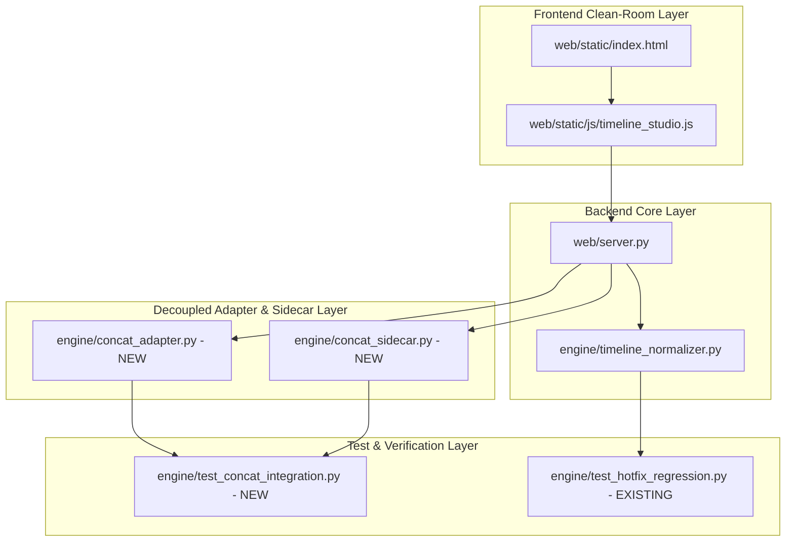
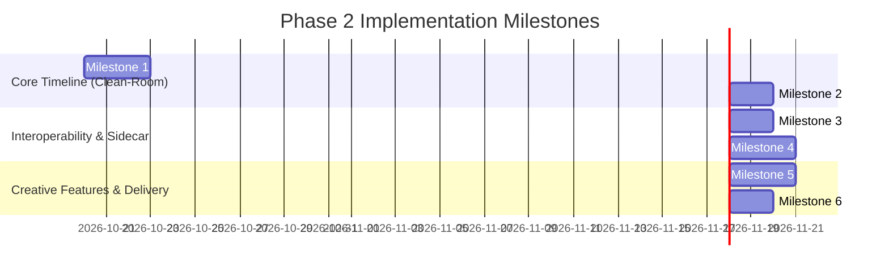

# Concat Phase 2 Implementation Plan & Roadmap

**Document Version:** 1.0.0  
**Phase:** 1 — Repository Audit & Integration Plan  
**Target:** RenderFlow Workstation Engine  
**Status:** EVIDENCE-BACKED IMPLEMENTATION SPECIFICATION (Awaiting Owner Approval)

---

## 1. Executive Summary & Objectives

This document establishes the exhaustive, step-by-step engineering roadmap for **Phase 2: Capability Integration**. Based on the Phase 1 audit, all core timeline editing capabilities (split, magnetic ripple trim, multi-clip drag, speed adjustments) will be delivered clean-room within RenderFlow's native UI and Python normalizer. Advanced GPU shader effects and AI video matting will be delivered through a completely decoupled loopback subprocess sidecar.

This plan guarantees:
- **Zero modification to production application code in Phase 1.**
- **Zero risk of AGPL/GPL copyleft infection across RenderFlow's proprietary engine.**
- **Strict preservation of RenderFlow's audio-first master timeline, 67 caption styles, and Ed25519 auto-updater.**
- **A fully testable, gated milestone progression with instant rollback capabilities.**

---

## 2. Exact Files & Modules Expected to Change



### 2.1 Existing Files Targeted for Modification (Phase 2 Only)

| File Path | Nature of Modification | Rationale & Scope |
| :--- | :--- | :--- |
| `web/static/js/timeline_studio.js` | Enhancement | Add split-at-playhead tool (`S`), magnetic ripple trim handles, multi-clip selection bounding box, and clip playback speed multiplier ($0.25\times\text{--}4.0\times$). |
| `web/static/index.html` | Enhancement | Add timeline toolbar action buttons (Split, Ripple Toggle, Snap Toggle) and optional Sidecar status pill. |
| `web/server.py` | Enhancement | Implement REST endpoints: `/api/timeline/split_clip`, `/api/timeline/trim_clip`, `/api/timeline/speed_curve`, and `/api/sidecar/status`. |
| `engine/timeline_normalizer.py` | Enhancement | Add mathematical normalization methods: `split_scene_at()`, `ripple_trim_scene()`, and `set_scene_speed()` with strict $5\text{ms}$ audio boundary enforcement. |
| `config/engine_config.json` | Configuration | Add feature flags: `enable_concat_sidecar: false`, `concat_sidecar_port: 0`, `concat_sidecar_path: "bin/concat-cli.exe"`. |

### 2.2 New Files to be Created in Phase 2

| File Path | Component Purpose | Dependencies |
| :--- | :--- | :--- |
| `engine/concat_adapter.py` | Bi-directional data adapter between `plan.json` and Concat `.concat` project JSON. | Standard Python `json`, `uuid`, `pathlib` |
| `engine/concat_sidecar.py` | Subprocess lifecycle manager for `concat-cli.exe`, loopback JSON-RPC 2.0 client, Win32 Job Object guard. | `socket`, `subprocess`, `threading`, `json` |
| `engine/test_concat_integration.py` | Comprehensive test suite validating adapter round-trips, split/trim accuracy, and sidecar IPC. | `unittest`, `pytest` |
| `tools/build_concat_sidecar.py` | Automation script for building standalone `concat-cli.exe` from source with accompanying source packaging. | Python 3, Rust Cargo toolchain |

---

## 3. Proposed Adapters & Data Contracts

### 3.1 Python Data Adapter: `engine/concat_adapter.py`

```python
from dataclasses import dataclass, field
from typing import Dict, List, Optional, Any
import uuid

@dataclass
class ConcatTimeRange:
    start_ms: int
    duration_ms: int

@dataclass
class ConcatClip:
    id: str
    track_id: str
    media_path: str
    range: ConcatTimeRange
    speed: float = 1.0
    transition_in: Optional[str] = None
    transition_duration_ms: int = 0

class ConcatProjectAdapter:
    """
    Translates between RenderFlow's native plan.json format
    and Concat's headless Document JSON format without data loss.
    """
    @staticmethod
    def plan_to_concat_document(plan: Dict[str, Any]) -> Dict[str, Any]:
        """Convert RenderFlow plan.json scenes to Concat multi-track document."""
        # 1. Master audio placed on Audio Track 0
        # 2. Scenes placed on Visual Track 1
        # 3. Transitions mapped to shader equivalents
        ...

    @staticmethod
    def concat_document_to_plan(doc: Dict[str, Any], base_plan: Dict[str, Any]) -> Dict[str, Any]:
        """Convert Concat document back to RenderFlow plan.json, enforcing audio master duration."""
        ...
```

### 3.2 Frontend Data Contract: `timeline_studio.js`

```typescript
interface TimelineEditCommand {
  type: 'SPLIT' | 'TRIM_RIPPLE' | 'MOVE_MULTI' | 'SET_SPEED';
  scene_id: string;
  split_time_sec?: number;
  delta_ms?: number;
  new_speed?: number;
  preserve_audio_sync: boolean; // Always true for RenderFlow
}
```

---

## 4. Build, Packaging & Licensing Implications

### 4.1 Packaging Isolation Architecture
RenderFlow will implement a **Two-Tier Packaging Strategy**:

```text
TIER 1: CORE WORKSTATION (Default Installer)
=============================================
Package: RenderFlow-Setup-v2.3.0.exe (Inno Setup)
Contents:
  - RenderFlow proprietary GUI & Python runtime
  - Native bin/ffmpeg.exe (9.0.2)
  - faster-whisper Small model
  - Clean-room Timeline Studio (Split, Ripple, Drag, Speed)
Licensing: RenderFlow Workstation Proprietary License
Copyleft Status: ZERO AGPL / ZERO GPL INFECTION

TIER 2: CREATIVE EXTENSIONS SIDECAR (Optional Add-On)
======================================================
Package: RenderFlow-Concat-Sidecar-v1.0.zip
Distribution: Downloaded on-demand via Update Center / Settings
Contents:
  - bin/concat-cli.exe (Compiled from Concat v0.2.7)
  - onnxruntime.dll (MIT)
  - licenses/CONCAT_AGPL_LICENSE.txt
  - licenses/THIRD_PARTY_NOTICES.txt
  - SOURCE_CODE_OFFER.md (Link to exact corresponding source tarball)
Communication: Loopback TCP JSON-RPC (127.0.0.1) across OS process boundary
```

### 4.2 Licensing Obligations Compliance Checklist
Before releasing Tier 2:
- [ ] Concat upstream source tarball corresponding to the exact compiled commit must be hosted on RenderFlow's GitHub release assets.
- [ ] The full text of GNU AGPL-3.0 and GNU GPL-3.0 must be placed alongside `concat-cli.exe`.
- [ ] RenderFlow's `About` dialog must include third-party attributions acknowledging Concat, Slint, and Peter Lin (RobustVideoMatting).
- [ ] No GPL or AGPL libraries may be placed in the Python `site-packages` or linked dynamically into `renderflow.exe`.

---

## 5. Dependency-Ordered Milestones



### Milestone 1: Clean-Room Timeline Editing (Frontend UI)
- **Goal:** Enable user timeline interactions directly in the browser canvas.
- **Tasks:**
  - Implement playhead split (`S` key) dividing a selected visual clip into two contiguous scenes.
  - Implement edge drag handles for trim with magnetic ripple mode (automatically sliding downstream scenes).
  - Add multi-clip selection with rubber-band box and batch move.
  - Add clip speed dialog ($0.5\times$, $1.0\times$, $1.5\times$, $2.0\times$).
- **Success Criteria:** User can split, trim, and reorder clips in `timeline_studio.js` with instant canvas feedback.

### Milestone 2: Timeline Normalizer Editing Engine & Audio Snap
- **Goal:** Backend validation and persistence of timeline edits.
- **Tasks:**
  - Implement `TimelineNormalizer.split_scene_at()`, `ripple_trim_scene()`, and `set_scene_speed()`.
  - Enforce integer millisecond normalization and gap-free continuity.
  - Add REST endpoints in `web/server.py` to persist changes to `plan.json`.
- **Success Criteria:** All modified timelines pass `TimelineNormalizer.validate_timeline()` with tolerance $\le 0.005\text{s}$.

### Milestone 3: Bi-Directional Concat Data Adapter
- **Goal:** Lossless translation between RenderFlow projects and Concat document format.
- **Tasks:**
  - Create `engine/concat_adapter.py`.
  - Implement `plan_to_concat_document()` and `concat_document_to_plan()`.
  - Unit test round-trip fidelity across 10 sample projects.
- **Success Criteria:** Exporting a `plan.json` to Concat document and back yields an identical, valid `plan.json`.

### Milestone 4: Isolated Subprocess Sidecar & JSON-RPC Protocol
- **Goal:** Robust, crash-resilient process lifecycle for `concat-cli.exe`.
- **Tasks:**
  - Create `engine/concat_sidecar.py`.
  - Implement dynamic port binding, Win32 Job Object termination guard, and JSON-RPC 2.0 client.
  - Implement handshake (`system.handshake`), ping, and graceful shutdown.
- **Success Criteria:** Sidecar boots, responds to JSON-RPC pings, and automatically terminates when RenderFlow exits.

### Milestone 5: Advanced GPU Effects & Background Cutout Integration
- **Goal:** Expose optional Concat GPU shaders and AI matting in RenderFlow.
- **Tasks:**
  - Implement cutout generation endpoint using Concat's MediaPipe/RVM model pipeline.
  - Add shader transition previews in RenderFlow UI.
  - Fall back gracefully to native FFmpeg if sidecar is disabled or unavailable.
- **Success Criteria:** Background removal produces clean alpha PNGs; preview shaders render without crashes.

### Milestone 6: Regression Verification, Packaging & Delivery Gate
- **Goal:** Comprehensive end-to-end regression validation.
- **Tasks:**
  - Run `engine/test_hotfix_regression.py` (9/9 pass).
  - Run `engine/test_production_acceptance_suite.py` (10/10 pass).
  - Run `tools/test_live_updater_lifecycle.py` (10/10 pass).
  - Run new `engine/test_concat_integration.py`.
- **Success Criteria:** 100% test pass rate, zero regressions, signed release artifacts verified.

---

## 6. Comprehensive Test Cases & Acceptance Criteria

| Test Suite / ID | Test Description | Target Verification | Passing Condition |
| :--- | :--- | :--- | :--- |
| **TC-TL-01** | Split at Playhead | Split a 6.0s scene at 2.5s | Produces two scenes: [0.0, 2.5] and [2.5, 6.0]. Zero gap, total duration identical. |
| **TC-TL-02** | Magnetic Ripple Trim | Trim 1.0s from scene 2 in a 10-scene project | All downstream scenes (3..10) shift backward by 1.0s. Master timeline snaps to audio. |
| **TC-TL-03** | Audio Sync Lock | User attempts to trim visual clips shorter than audio | Normalizer holds final scene image to prevent audio cut-off. |
| **TC-AD-01** | Concat Adapter Round-Trip | Convert `plan.json` -> Concat Doc -> `plan.json` | JSON structure preserves all scenes, timings, transitions, and audio bindings. |
| **TC-SC-01** | Sidecar Process Guard | Kill RenderFlow process forcefully via Task Manager | `concat-cli.exe` terminates immediately via Win32 Job Object (zero orphaned tasks). |
| **TC-SC-02** | Sidecar Crash Recovery | Force kill `concat-cli.exe` during render preview | RenderFlow detects socket closure, logs diagnostic warning, and falls back to native FFmpeg. |
| **TC-RG-01** | 21.07s Discrete Cut Boundary | Run `engine/test_hotfix_regression.py` Condition 5 | Scene boundary at 21.07s passes across 30, 29.97, 24, 25, 60 fps without frame bleeds. |
| **TC-UP-01** | Updater Invariance | Run `tools/test_live_updater_lifecycle.py` | All 10 update lifecycle tests pass against live production CDN without signature errors. |

---

## 7. Rollback Strategy & Feature Flags

To ensure absolute operational safety:
1. **Engine Feature Flags (`config/engine_config.json`):**
   ```json
   {
     "features": {
       "enable_timeline_editing": true,
       "enable_concat_sidecar": false,
       "fallback_to_native_ffmpeg": true
     }
   }
   ```
2. **Instant Deactivation:**  
   Setting `"enable_concat_sidecar": false` completely disables the sidecar subsystem. RenderFlow runs in pure native mode with zero attempts to spawn or communicate with `concat-cli.exe`.
3. **UI Graceful Degradation:**  
   If the sidecar binary is absent, GPU shader transitions and AI cutout buttons in the UI are cleanly badged with an "Install Creative Extension" prompt, rather than throwing errors.
4. **Git Versioning Guard:**  
   All Phase 2 implementation will occur on an isolated feature branch (`feature/concat-integration`), leaving `main` and production release tags untouched until all Milestone 6 gates pass.

---

## 8. Estimated Complexity, Effort & Blockers

| Milestone | Estimated Effort | Technical Complexity | Key Risk / Blocker |
| :--- | :--- | :--- | :--- |
| **M1: Clean-Room UI Editing** | 3 Working Days | Medium | Canvas event handling & multi-touch drag responsiveness. |
| **M2: Normalizer Logic & Backend** | 2 Working Days | Medium | Floating-point accumulation drift during ripple trims. |
| **M3: Concat Project Adapter** | 2 Working Days | Low | Schema mismatches in transition parameter curves. |
| **M4: Sidecar IPC & Lifecycle** | 3 Working Days | High | Windows firewall / loopback socket permissions. |
| **M5: GPU Effects & AI Cutouts** | 3 Working Days | High | GPU driver incompatibilities on low-end Intel iGPUs. |
| **M6: Verification & Delivery Gate**| 2 Working Days | Medium | Ensuring 100% pass across all regression test suites. |
| **TOTAL PHASE 2 ESTIMATE** | **15 Working Days** | **High Overall** | **No blockers identified that prevent execution.** |

---

## 9. Phase 1 Completion Sign-Off

With the delivery of all 6 architectural audit and planning documents, **Phase 1 is officially complete**:
1. `docs/CONCAT_REPOSITORY_AUDIT.md` (Upstream Rust, Slint, and crate architecture audited)
2. `docs/CONCAT_LICENSE_AND_DEPENDENCY_REVIEW.md` (AGPL-3.0 copyleft isolation and clean-room strategy verified)
3. `docs/RENDERFLOW_CURRENT_ARCHITECTURE.md` (Audio-first master timeline and FFmpeg engine documented)
4. `docs/CONCAT_INTEGRATION_ARCHITECTURE.md` (Hybrid decoupled architecture and JSON-RPC contracts designed)
5. `docs/CONCAT_COMPATIBILITY_AND_RISKS.md` (Drift, cut precision, memory, and hardware risks mitigated)
6. `docs/CONCAT_PHASE_2_IMPLEMENTATION_PLAN.md` (Milestone roadmap, exact files, tests, and rollback strategy defined)

> **CRITICAL STOP:**  
> In accordance with the project instructions, **zero production code has been modified**. Execution now pauses to allow the repository owner and stakeholders to review the architectural deliverables and authorize Phase 2 implementation.
