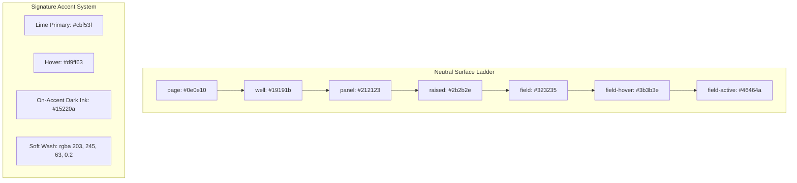

# Concat UI/UX Audit & Visual Specification

**Document Version:** 1.0.0  
**Phase:** 2A — UI/UX Replication & Timeline MVP  
**Target:** RenderFlow Workstation Engine  
**Reference Source:** Concat (v0.2.7, Commit `e4a6a57` in `scratch/concat_upstream`)  
**Status:** **SOURCE-VERIFIED AUDIT** (Clean-Room Analysis)

---

## 1. Executive Summary & Verification Methodology

This audit provides a rigorous, evidence-based decomposition of the real Concat user interface. Rather than relying on external marketing materials or assumptions, every specification documented here was extracted directly from the upstream Slint source definitions in `scratch/concat_upstream/src/crates/concat/ui/`.

### Verified Source File Inventory:
- `theme/dark.slint`: Exact neutral grey surface ladder, accent palettes, and media kind colors.
- `workspace/workspace.slint`: Dynamic pane tree, splitter gutters, and window resizing arbitration.
- `workspace/preview-pane.slint`: Program monitor stage, frame-based timecode, and transport tray.
- `workspace/media-pane.slint`: Library tab strip, filter sidebar, and asset card structures.
- `workspace/config-pane.slint`: Two-state properties inspector (project details vs clip inspector).
- `timeline/lanes.slint`: Multi-track lanes, alternating track banding, clip markers, and playhead needle.

---

## 2. Design System & Design Tokens (Source: `dark.slint`)

Concat implements a sophisticated "neutral grey surface ladder" with no blue or purple cast, allowing media colors and accent highlights to dominate visual hierarchy.



### 2.1 Color Tokens Table

| Token Name | Hex / RGBA Value | Semantic Purpose in Concat |
| :--- | :--- | :--- |
| `page` | `#0e0e10` | The deepest ground under all panes; visible in gutters. |
| `panel` | `#212123` | Base surface for panes (Media, Monitor, Inspector, Timeline). |
| `well` | `#19191b` | Sunken floor for canvas stage and track containers. |
| `raised` | `#2b2b2e` | Elevated cards, toolbar buttons, and floating chips. |
| `field` | `#323235` | Input fields, search boxes, and dropdown triggers. |
| `field-hover` | `#3b3b3e` | Hover state for buttons and inputs. |
| `field-active` | `#46464a` | Pressed/active state for inputs. |
| `line` | `rgba(255, 255, 255, 0.10)` | Hairline dividers and pane boundaries. |
| `line-strong` | `rgba(255, 255, 255, 0.20)` | Active separators and focused borders. |
| `fg` | `#f5f5f7` | Primary text and icons. |
| `fg-muted` | `#a1a1a6` | Secondary labels, descriptions, and timecode units. |
| `fg-dim` | `#6e6e73` | Group headings, empty states, and disabled controls. |
| `accent` | `#cbf53f` | **Signature Lime Accent**: Selection border, playhead needle, active tool. |
| `on-accent` | `#15220a` | Deep ink rendered on top of lime accent buttons. |
| `playhead` | `#cbf53f` | Playhead line and scrub handle tag. |

### 2.3 Typography, Type Scale & Component Metrics (Source: `theme.slint`)

Concat explicitly defines every metric, font role, type scale, and radius in `theme/theme.slint`:

| Property Token | Value | Semantic Role in Concat |
| :--- | :--- | :--- |
| **`font`** | `"Hanken Grotesk"` | Interface type for all labels, menus, panel titles, dialogs, and body text. |
| **`font-technical`**| `"Hanken Grotesk"` / Tabular | Numeric values: timecodes, ruler coordinates, clip durations, file sizes, framerates. |
| **`weight-body`** | `400` | Regular body text across cards and inspector rows. |
| **`weight-title`**| `500` | Medium weight for panel headers, section headings, and tab labels. |
| **`weight-display`**| `700` | Bold weight for brand wordmark in title bar and launch headings. |
| **`fs-xs`** | `10px` | Smallest badges, format stamps, audio track channels, tiny chips. |
| **`fs-sm`** | `11px` | Section subheadings, compact timecodes, secondary labels. |
| **`fs`** | `12px` | **Base UI Size** inherited by all panels, controls, and lists. |
| **`fs-lg`** | `13px` | Panel titles and emphasized labels. |
| **`fs-xl`** | `14px` | Content titles, project filenames. |
| **`fs-input`** | `15px` | Text inputs and numeric scrub fields. |
| **`fs-display`** | `34px` | Hero display headings. |
| **`r-xs`** | `3px` | Micro badges, status indicators, keyboard shortcuts. |
| **`r-sm`** | `5px` | Compact buttons, inputs, segmented controls, tabs. |
| **`r`** | `7px` | Base card and panel border radius. |
| **`r-lg`** | `12px` | Large floating cards and popovers. |
| **`r-xl`** | `16px` | Modal dialog sheets. |
| **`h`** | `28px` | **Standard NLE control height** (buttons, dropdowns, inputs). |
| **`gap`** | `6px` | Spacing between controls and fields in a row. |
| **`pad`** | `14px` | Panel horizontal padding. |
| **`label-w`** | `62px` | Fixed width for muted property labels in inspector rows. |
| **`tray-h`** | `40px` | Timeline tool tray height. |

### 2.2 Media Kind Color System

Every media asset wears a distinct two-tone color identity shared between its library card in the bin and its clip block on the timeline:

| Media Kind | Mark Color (`mark`) | Well Color (`well`) | Waveform / Icon Color |
| :--- | :--- | :--- | :--- |
| **Video** | `#3373d1` (Royal Blue) | `#142238` (Deep Blue-Black) | White text, film icon |
| **Audio** | `#34c46f` (Vivid Green) | `#12301c` (Deep Forest) | `rgba(167, 240, 194, 0.70)` (Wave wash) |
| **Image** | `#9f63d6` (Violet) | `#2a1e34` (Deep Purple) | Still format stamp (`.png`) |
| **Text / Captions** | `#cf5a99` (Magenta/Rose) | `#321c29` (Deep Berry) | Typography icon |
| **Filter / FX** | `#6d63e8` (Indigo) | `#23204a` (Deep Indigo) | Shader badge |

---

## 3. Workspace Layout & Visual Hierarchy

The Concat workspace (`workspace.slint`) is organized into an upper 3-pane split and a lower full-width timeline pane, separated by 8px gutters:

```text
+---------------------------------------------------------------------------------------------------+
|  CONCAT TITLE BAR: [Project Title]  [Undo ↩] [Redo ↪]             [Playhead: 00:01:24:12] [Export ⚡] |
+------------------------------------+------------------------------------+-------------------------+
| MEDIA LIBRARY PANE                 | PROGRAM PREVIEW MONITOR            | PROPERTIES INSPECTOR    |
| - Tabs: Media, Audio, Text, FX     | - Sunken Stage Viewport (#19191b)  | - Clip / Project Specs  |
| - Filter Sidebar (All, Video...)   | - Resolution: 1920x1080 (16:9)     | - Transform: X, Y, Scale|
| - Search Bar & Grid Cards          | - Transport Tray:                  | - Timing: In, Out, Dur  |
| - Waveform & format stamps         |   |◀  ◀  [ ▶ ]  ▶  ▶|             | - Transitions: Type, Len|
|                                    |   00:00:12:04 / 00:01:45:00        | - Captions Typography   |
+------------------------------------+------------------------------------+-------------------------+
| MULTI-TRACK TIMELINE PANE                                                                         |
| - Toolbar: [🧲 Snap: ON]  [✂️ Split (S)]  [🗑️ Del]  [🔍 Zoom Slider]                                |
| - Timecode Ruler: Millisecond & frame ticks with Lime Playhead Handle [00:12.15]                  |
| - Track 1 (Text/Captions):   [ Clip 1: Title ]       [ Clip 2: Subtitle ]                         |
| - Track 2 (Video Scenes):    [ Clip 01 (Image) ]-----[ Clip 02 (Image) ]-----[ Clip 03 (Image) ]  |
| - Track 3 (Master Narration):[ ~~~~~~~~~ Waveform Audio Envelope ~~~~~~~~~~~~~~~~~~~~~~~~~~~~~~ ] |
+---------------------------------------------------------------------------------------------------+
```

### 3.1 Upper Workspace Regions
1. **Left: Media Library Pane (`media-pane.slint`)**
   - **Tab Strip:** `Media`, `Audio`, `Text`, `Transitions`, `Effects`, `Templates`.
   - **Filter Sidebar:** Category shelf narrowing assets to `All`, `Video`, `Audio`, `Images`, `Speech/Generated`.
   - **Card Grid:** Thumbnail previews with duration badges, file extension tags (`PNG`, `WAV`), and drag-and-drop triggers.
2. **Center: Program Preview Monitor (`preview-pane.slint`)**
   - Sunken stage viewport (`#19191b`) with 16:9 aspect ratio bounding box.
   - Transport controls dead-center: Step Back (`◀`), Play/Pause (`▶`/`⏸`), Step Forward (`▶`), Jump Start (`|◀`), Jump End (`▶|`).
   - Frame-accurate timecode display on leading edge (`00:00:12:04`).
   - Aspect ratio and zoom selector on trailing edge (`16:9`, `9:16`, `1:1`, `Fit`).
3. **Right: Properties & Inspector Pane (`config-pane.slint`)**
   - **Default State (Nothing Selected):** Project facts (Resolution, Framerate, Master Duration, Clip Count).
   - **Active State (Clip Selected):**
     - Timing Breakdown (Start time, End time, Duration, Speed multiplier).
     - Transition Controls (Transition type, duration slider).
     - Motion / Transform (Pan/Zoom profile, Scale, Crop).
     - Text / Captions Controls (Font family, weight, fill color, stroke width).

### 3.2 Lower Workspace: Multi-Track Timeline (`timeline/lanes.slint`)
- **Track Headers:** Left column with Track Name, Kind Icon, Mute (`🔇`), and Lock (`🔒`).
- **Banded Lanes:** Track floor alternates between `#1a1a1c` and `#1e1e20` for visual separation.
- **Ruler:** `#171719` floor with dynamic division lines and text stamps (`00:01.00`, `00:02.00`).
- **Signature Playhead:** `#cbf53f` Lime needle traversing all tracks, topped by a pentagonal scrub handle displaying the exact current timecode.
- **Clip Cards:**
  - Colored header strip according to media kind (`#3373d1` video, `#9f63d6` image, `#34c46f` audio).
  - Thumbnail box, clip name, duration text, and transition overlap badges.
  - Selection Highlight: 2px solid `#cbf53f` Lime border with glow (`rgba(203, 245, 63, 0.6)`).
  - Edge drag handles for left/right trimming.

---

## 4. Interaction Patterns & Keyboard Shortcuts

| Action | Shortcut | Observable Behavior in Concat |
| :--- | :--- | :--- |
| **Split at Playhead** | `S` | Slices active clip into two contiguous segments at exact playhead frame. |
| **Play / Pause** | `Space` | Toggles playback; playhead advances synchronously across timeline. |
| **Step Backward** | `Left Arrow` / `◀` | Decrements playhead by exactly 1 frame ($1/30\text{s}$). |
| **Step Forward** | `Right Arrow` / `▶` | Increments playhead by exactly 1 frame ($1/30\text{s}$). |
| **Jump to Start** | `Home` / `|◀` | Moves playhead to timestamp `00:00.00`. |
| **Jump to End** | `End` / `▶|` | Moves playhead to total project duration. |
| **Delete Selected Clip**| `Del` / `Backspace` | Removes clip from track and adjusts timeline. |
| **Undo Edit** | `Ctrl + Z` | Restores previous timeline snapshot. |
| **Redo Edit** | `Ctrl + Y` | Reapplies undone timeline edit. |
| **Magnetic Snapping** | Toggle `🧲` | Snaps dragged playhead or cut boundaries to 8px proximity thresholds. |

---

## 5. Verified Elements vs Assumptions

### Verified from Source Code (`scratch/concat_upstream`):
- Exact color hex values in `dark.slint` (`#0e0e10`, `#212123`, `#cbf53f`, `#3373d1`, `#34c46f`, etc.).
- 3-pane upper layout and multi-track lower timeline structure.
- Frame-based timecode readout and central transport bar.
- Two-state inspector (project summary when empty, clip attributes when selected).
- Split-at-playhead shortcut `S` and spacebar transport.

### Architectural Distinctions for RenderFlow Adaptation:
- **Audio-First Invariant:** Concat uses a video-first timeline where audio is secondary. RenderFlow strictly enforces that **Narration Audio is the Master Timeline**.
- **Web Stack Implementation:** Concat renders via Slint/Skia/wgpu in Rust. RenderFlow adapts these visual specifications cleanly in HTML5 Canvas, Vanilla CSS, and JavaScript.
