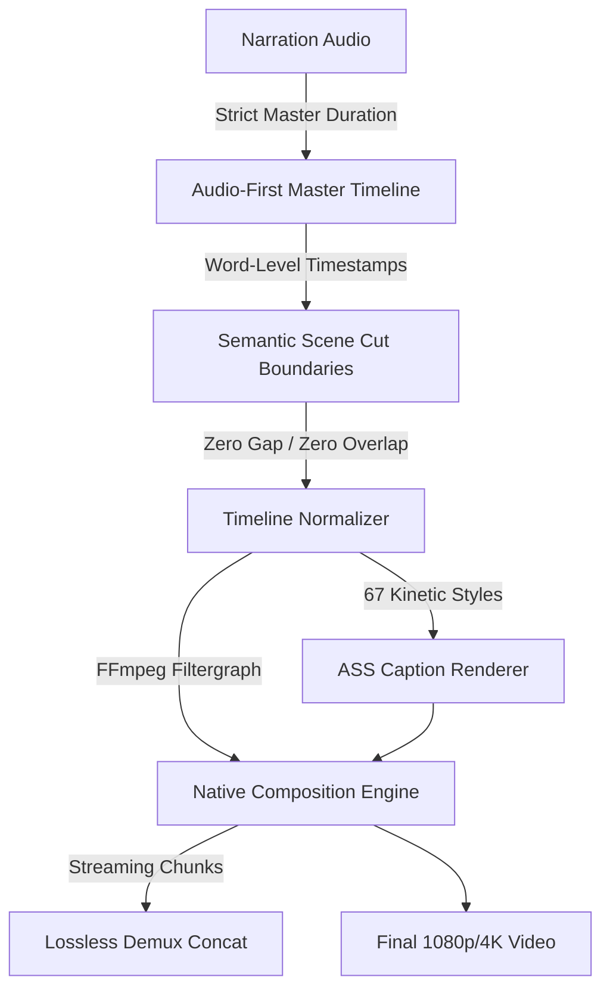

# RenderFlow Current Architecture & Core Pipeline Review

**Document Version:** 1.0.0  
**Phase:** 1 — Repository Audit & Integration Plan  
**Target:** RenderFlow Workstation Engine (Version 2.2.4)  
**Status:** EVIDENCE-BACKED AUDIT (Zero Production Code Changes)

---

## 1. Executive Summary

RenderFlow is a specialized, high-performance desktop workstation application designed for automated and timeline-assisted video production. Its primary technological differentiator is an **Audio-First Video Composition Pipeline** powered by native FFmpeg filtergraphs, synchronized word-level kinetic captions, and cryptographic in-app auto-updating.

This document establishes the verified baseline of RenderFlow's architecture prior to any Concat integration. Every architectural invariant documented here must be strictly preserved throughout subsequent integration phases.

---

## 2. Core Architectural Invariants

The following four foundational principles govern the RenderFlow engine:



1. **Audio-First Invariant:** The master narration audio file strictly defines the duration, tempo, and cut boundaries of the entire project. Video clips and images adapt to the audio, never the reverse.
2. **Deterministic Discrete Cut Seeking:** Cuts occur at exact mathematical timestamps (with tolerance $\le 0.005$ seconds). Verification tools (`verify_output.py`) mathematically inspect frame boundaries across transitions and chunks.
3. **Bounded Memory Execution (< 150 MB RAM):** By delegating image scaling, blending, and encoding to native FFmpeg subprocesses operating in streaming chunks, RenderFlow renders hours-long 4K projects without Python heap memory bloat.
4. **Cryptographic Release & Update Integrity:** RenderFlow features an immutable RFC 8032 Ed25519 signature verification pipeline for software updates, verified directly against an embedded master public key.

---

## 3. Subsystem Breakdown

### 3.1 Native FFmpeg Rendering & Export Architecture (`engine/fast_pipeline.py`)

- **Design Philosophy:** Avoids slow per-frame Python/OpenCV loops. All video compositing, image scaling, overlaying, transition blending, and audio mixing are compiled into complex FFmpeg filtergraphs (`-filter_complex`).
- **Core Orchestrator:** `fast_pipeline.py::run_fast_pipeline()` manages asset validation, deterministic pre-processing, chunking, and final concatenation.
- **Hardware Acceleration:** `engine/hardware_detector.py` automatically detects available GPUs and configures optimal encoders:
  - NVIDIA NVENC (`h264_nvenc`, `hevc_nvenc`)
  - AMD AMF (`h264_amf`, `hevc_amf`)
  - Intel QuickSync (`h264_qsv`, `hevc_qsv`)
  - CPU Libx264 Fallback (`libx264` with preset `medium` or `veryfast` on systems with $< 8.0$ GB RAM)
- **Deterministic Image Preprocessing Cache:** Source images are hashed using SHA-256 and pre-scaled to uniform target canvas dimensions (1920x1080 or 3840x2160) using Lanczos filtering, saved into `.cache/image_preproc/`.
- **Duration-Independent Chunking:**
  - Projects with $\le 40$ scenes render in a single-pass filtergraph.
  - Projects with $> 40$ scenes (10 min to 60+ min) are dynamically divided into chunks (calculated via `render_profiles.py::get_adaptive_chunk_size()`). Each chunk is rendered independently to a temporary MP4, followed by instant lossless concatenation via FFmpeg concat demuxer (`-c copy`) in $2\text{--}3$ seconds.
- **Watchdog & Heartbeat Monitor:** `fast_pipeline.py::HeartbeatWatchdog` continuously samples FFmpeg progress pipes, calculating rendering FPS, memory utilization, and time-to-completion while protecting against deadlocks.

### 3.2 Audio-First Narration & Speech Synchronization (`engine/sync_engine_v3.py`)

- **Speech-to-Text Pipeline:** Uses `faster-whisper` (Small model bundled in `models/whisper/`) with local CTranslate2 execution.
- **Word-Level Alignment:** Produces millisecond-accurate word start/end timestamps.
- **Semantic Beat Detection:** `SemanticBeatEngine` aggregates words into visual rhythmic units ($1.5\text{s}$ to $7.5\text{s}$) aligned to grammatical pauses, punctuation, and speaker emphasis.
- **Silence & Pause Preservation:** Speech pauses are never dropped. As documented in `engine/timeline_normalizer.py`, silences are explicitly mapped either as visual image holds or explicit hold intervals, guaranteeing zero missing time across the master duration.
- **Multi-Signal Image Retrieval:** `SyncEngineV3` extracts structured visual entities (objects, actions, themes) and scores candidate assets across semantic embeddings, OCR content, and visual continuity tags.

### 3.3 Scene Planning, Cut Boundaries & Captions (`engine/timeline_normalizer.py`, `engine/caption_engine.py`)

- **Timeline Normalizer:** `engine/timeline_normalizer.py` enforces mathematical timeline continuity:
  - Converts all timestamps to integer milliseconds (`sec_to_ms`, `ms_to_sec`) to eliminate floating-point drift.
  - Guarantees `scene[n].start == scene[n-1].end`.
  - Enforces strict tolerance: $| \text{timeline\_duration} - \text{audio\_duration} | \le 0.005\text{s}$.
- **Caption System:**
  - Features 67 distinct, designer-crafted kinetic typography styles in `engine/caption_styles.py` (e.g. `cinematic_gold`, `hormozi_bold`, `cyberpunk_neon`, `mrbeast_pop`, `karaoke_gradient`).
  - `engine/caption_ass.py` generates Advanced SubStation Alpha (`.ass`) subtitle files with millisecond word highlighting, dynamic scaling, drop shadows, and color ramps.
  - Subtitles are burned into video frames directly in the FFmpeg filtergraph using the `ass` filter (`ass=subtitles.ass`).

### 3.4 Web Editor & Frontend Timeline Studio (`web/static/js/timeline_studio.js`)

- **User Interface:** High-performance HTML5 Canvas and DOM-based multi-track editor.
- **Track Architecture:**
  - Track 1: Master Narration Audio (waveform visualization, mute, solo).
  - Track 2: Visual Media Track (scene image/video blocks, cut boundary handles, transition indicators).
  - Track 3: B-Roll / Overlay Track (PiP, transparent PNG badges).
  - Track 4: Kinetic Captions Track (word timing segments, style selector).
  - Track 5: Background Music & SFX Track (ducking volume controls).
- **Interactive Controls:** Zoomable time ruler, draggable playhead, real-time audio playback synchronization, transition duration adjustments, and visual drag-and-drop.
- **FastAPI Server Lifecycle (`engine/server_lifecycle.py`, `web/server.py`):**
  - Manages background process lifecycle on `localhost:8000`.
  - Single-instance mutex lock via `.renderflow_instance.json`.
  - REST endpoints for project management, audio transcription, timeline updates, preview scrubbing, and render triggers.

### 3.5 Media Storage & Project Format

- **Project Workspace Structure:**
  ```text
  projects/<project_id>/
  ├── plan.json           # Comprehensive project manifest
  ├── audio/              # Master narration and SFX tracks
  ├── images/             # User-imported and synchronized visuals
  ├── captions/           # Generated ASS files and transcript data
  └── output/             # Final exported MP4s and QC reports
  ```
- **The `plan.json` Contract:** JSON schema capturing project settings (width, height, fps), scenes array (each with `scene_id`, `start_time`, `end_time`, `duration`, `image_path`, `transition_in`, `transition_duration`, `caption_text`), audio metadata, and render flags.

### 3.6 Installer, Auto-Updater & Cryptographic Security (`engine/updater.py`, `engine/crypto_ed25519.py`)

- **Cryptographic Authentication:**
  - Manifests (`update_manifest.json`) are authenticated using RFC 8032 Ed25519 signatures.
  - Embedded Master Public Key: `661a024a191bfeb43cc9cc8412676dd8064fd1686ca3bdf9cb604ef71b24830e`.
  - Prevents MITM attacks, manifest tampering, or unauthorized update execution.
- **In-App Auto-Updater Workflow:**
  1. Polls raw GitHub manifest (`https://raw.githubusercontent.com/atifshahzad7861122-lgtm/RenderFlow/main/release/update_manifest.json`).
  2. Verifies cryptographic signature against payload content.
  3. Checks semantic version against `engine/version.py::__version__`.
  4. Downloads verified patch ZIP or full setup EXE with SHA-256 validation.
  5. Performs atomic in-place file replacement with automated rollback to `.rollback_backup/` upon error.
- **Packaging:** Built with Inno Setup (`installer/renderflow_setup.iss`) bundling Python, pre-extracted FFmpeg, faster-whisper models, and application web assets.

---

## 4. Current Test Suites & Regression Baselines

RenderFlow enforces an extensive, deterministic test matrix before any build is qualified:

| Test File | Focus Area | Verified Pass Criteria |
| :--- | :--- | :--- |
| `engine/test_hotfix_regression.py` | Cut boundary integrity, 21.07s boundary test, timebase conversion, transition overlap offsets | 9/9 Tests Passing |
| `engine/test_production_acceptance_suite.py` | End-to-end pipeline, hardware detection, chunked concat, ASS burning, audio sync | 10/10 Tests Passing |
| `engine/test_in_app_updater.py` | Ed25519 signature checks, hash mismatches, rollback, manifest parsing | 10/10 Tests Passing |
| `tools/test_live_updater_lifecycle.py` | Live production GitHub CDN asset checks, download progress, patch staging | 10/10 Tests Passing |
| `engine/test_timeline_continuity.py` | Silence preservation, floating-point drift elimination, gap tolerance | All Tests Passing |
| `engine/test_caption_suite.py` | 67 style definitions, ASS formatting, word timing validation | All Tests Passing |

---

## 5. Architectural Compatibility Requirements for Concat

Any integration with Concat must respect the following RenderFlow system interfaces:

1. **`plan.json` Integrity:** The scene graph representation must remain serializable to RenderFlow's native schema.
2. **Timeline Normalization Rules:** Any cut, trim, or move command executed from the UI or an external tool must pass through `TimelineNormalizer` validation before submission to `fast_pipeline.py`.
3. **No Dynamic Linker Pollution:** No GPL/AGPL dynamic libraries may be imported into the Python runtime process.
4. **Updater Manifest Invariance:** Release distribution hashes, Ed25519 public keys, and GitHub release naming schemas must not be altered.
